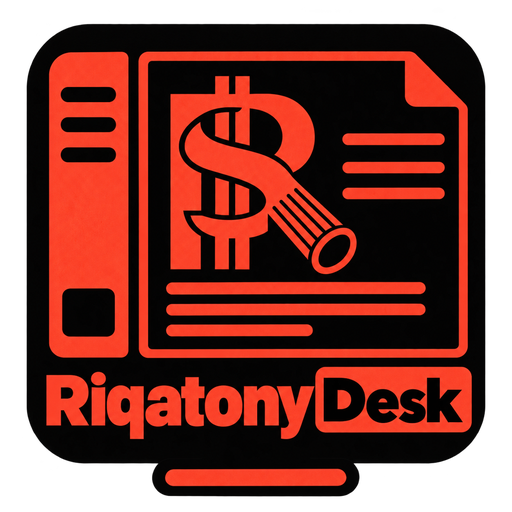

<p align="center">

Current source edition: RiqatonyDesk 1.0.0-x19.5.
  <a href="https://github.com/brunonlinespace/riqatonydesk">
    
  </a>
</p>

# RiqatonyDesk

**Friendly. Fast. Focused.**

RiqatonyDesk is a workspace-scale Rich Text Format editor built around RiqatonyPad's standards-based RTF engine and Ribbon interface. It adds managed workspaces, folder navigation, dashboards, persistent application settings, and the shared Desk-family document lifecycle while continuing to read and write ordinary `.rtf` files.

Current release: **1.0.0**

Repository: <https://github.com/brunonlinespace/riqatonydesk>

## What RiqatonyDesk is

RiqatonyDesk is designed for people who want RiqatonyPad's rich-text editing inside a larger, persistent workspace. A workspace is an ordinary folder containing RTF documents and subfolders; RiqatonyDesk does not introduce a private document format or require documents to be stored in a database.

Only the active workspace is scanned and watched. Files opened from outside that workspace can be viewed as transient external sessions without being copied into workspace navigation.

## Highlights

- Standards-based **RTF editing** powered by the RiqatonyPad editor engine.
- Registered **Workspaces** with fast switching and recursive folder navigation.
- **My Workspace** sidebar with native folder/file distinction, expandable folders, Dashboard access, and adjacent-file navigation.
- Workspace and folder **Dashboards** with List and Grid views.
- Full-width **Ribbon** with File, Home, Insert, Configure, and Help pages.
- Persistent **Tabs Enabled / Tabs Disabled** behavior with genuine document-lifecycle semantics.
- Shared multi-document resolution when disabling tabs or exiting with several at-risk documents.
- Persistent **Locked Mode** and temporary **Focused Mode**.
- Persistent **File Header**, Sidebar, Status, and Dashboard view settings, including **Left Sidebar / Right Sidebar** positioning and **Shift+F9** side toggling.
- **Import File into Workspace...** and **Open External File...** as separate workflows.
- Safe create, rename, duplicate, move, import, delete, and Save As operations.
- Atomic RTF saving, external-change detection, and protection when an open backing file is deleted or renamed away.
- System, Dark, and Light application themes with independent editor-canvas control.
- Family-style bottom Find / Replace panel with gold match highlighting and bounded RTF-safe replacement, searchable Keyboard Shortcuts, Quick Tour, and bundled documentation.
- Four selectable command-icon families with light and dark variants.

## Interface

### Ribbon

The Ribbon is the primary command surface and remains above the workspace sidebar and content area.

- **File** — create, save, print, export, workspace/session, import, and external-file actions.
- **Home** — clipboard, font, formatting, paragraph, alignment, and editing commands.
- **Insert** — links, images, tables, horizontal rules, symbols, dates, and times.
- **Configure** — view controls, editor settings, themes, icon families, Dashboard behavior, launch behavior, and tab behavior.
- **Help** — documentation, Quick Tour, shortcuts, GitHub, issues, and About.

Hover over a Ribbon command to see its name and keyboard shortcut. When Document Tabs are disabled, **Ctrl+Tab** and **Ctrl+Shift+Tab** cycle Ribbon pages; when tabs are enabled, those shortcuts navigate document/context tabs.

### AppMenu

The native application menu is organised as:

**File · Edit · Format · Insert · View · Settings · Help**

The Keyboard Shortcuts dialog uses the live application actions, so newly assigned shortcuts remain visible there.

## Workspaces

RiqatonyDesk keeps workspace registration separate from the files themselves.

- **Open / Manage Workspaces...** registers, relabels, relinks, or removes workspace registrations.
- Removing a registration does **not** delete its folder or documents.
- Only the active workspace is scanned and watched.
- **Refresh Workspace** rescans the active workspace.
- The sidebar is ordered around **My Workspace**, Dashboard, tree controls, the navigation tree, and Refresh Workspace at the bottom.
- Folders and files use distinct native tree icons while retaining the same navigation and drag/drop behavior.
- **F2** renames the active file or selected workspace subfolder according to context.

### Import and external files

RiqatonyDesk deliberately distinguishes the two operations:

- **Import File into Workspace...** copies a supported external RTF into the active workspace root.
- **Open External File...** opens a supported RTF through the existing transient external-file lifecycle without importing it.

These commands now have dedicated shortcuts:

- `Ctrl+Alt+Shift+I` — Import File into Workspace...
- `Ctrl+Alt+Shift+O` — Open External File...

### Drag and drop

External RTF files dropped onto workspace/navigation targets are imported into the applicable workspace folder. Managed documents dragged onto workspace folders are moved through RiqatonyDesk's existing safe file operations.

Editor-surface external opening remains separate from workspace import behavior.

## Editing

RiqatonyDesk retains RiqatonyPad's rich-text editing model. Supported operations include:

- font family and size;
- bold, italic, underline, strikethrough, superscript, and subscript;
- text colour and highlighting;
- paragraph styles and line spacing;
- left, centre, right, and justified alignment;
- bullet lists and indentation;
- links and images;
- tables and table editing;
- horizontal rules;
- symbols;
- date and time insertion;
- print and PDF export.

New workspace documents are created as complete RTF documents from the configured New Document Defaults. The user-facing creation command is simply **New File**.

## Document tabs

RiqatonyDesk keeps the established user-facing setting names:

- **Tabs Enabled** — multiple documents may remain open at once.
- **Tabs Disabled** — only the active document remains open; navigating elsewhere safely closes it first.

When Tabs Enabled is switched off, the current context remains the anchor. Clean background documents close automatically, while dirty or otherwise at-risk documents are resolved before the change completes.

The same multi-document resolution path is used when exiting with several documents requiring attention.

## File safety and external changes

RiqatonyDesk treats file safety as part of the normal document lifecycle.

Ordinary saves use guarded replacement semantics. Before replacing an existing file, RiqatonyDesk detects whether its disk content changed externally and offers safe resolution paths rather than silently overwriting another program's changes.

Open documents also survive an externally driven delete or rename-away of their backing path. A missing-backed document remains open and protected: Reload is unavailable while no disk copy exists, Save Version As remains available, and recreating the original path requires an explicit action.

Tabs Disabled does not keep hidden editors alive, so this protection applies only to documents that are genuinely open.

## Locked Mode

**Locked Mode** (`F12`) is a persistent protection state. It prevents document mutation while preserving navigation, search, selection, and copying.

The active window title identifies Locked Mode when applicable.

## Focused Mode

**Focused Mode** (`F10`) temporarily hides surrounding application chrome and collapses the Ribbon. Leaving Focused Mode restores the independent visibility state that existed before it was entered.

Focused Mode does not overwrite the user's normal layout preferences.

## Appearance

Choose **System**, **Dark**, or **Light** for the application shell. The editor canvas can be controlled independently through **Dark Editor**.

RiqatonyDesk provides four selectable command-icon families, in dark and light variants, 144 icons each. Command buttons use the established 52×52 geometry with 36×36 icons:

- **Riqa Icons Harmony**
- **Riqa Icons Humility**
- **Riqa Icons Heritage**
- **Riqa Icons Halcyon**

The Dashboard reuses the active icon family for **New File**, **New Folder**, and the dynamic **Grid View / List View** toggle.

## Useful keyboard shortcuts

| Shortcut | Action |
| --- | --- |
| `Ctrl+N` | New File |
| `Ctrl+Shift+N` | New Folder |
| `Ctrl+Alt+Shift+N` | New Window |
| `Ctrl+O` | Open / Manage Workspaces |
| `Ctrl+Alt+Shift+I` | Import File into Workspace |
| `Ctrl+Alt+Shift+O` | Open External File |
| `Ctrl+Shift+F5` | Refresh Workspace |
| `Ctrl+S` | Save |
| `Ctrl+Shift+S` | Save and New |
| `Ctrl+W` | Close Tab / Dashboard |
| `Ctrl+Shift+W` | Save and Dashboard |
| `Ctrl+Shift+Q` | Save and Exit |
| `Ctrl+Up` / `Ctrl+Down` | Previous / Next File |
| `F2` | Rename File or Folder |
| `Ctrl+F` | Find; press again while Find has focus to close |
| `Ctrl+H` | Find and Replace; press again while Replace has focus to close |
| `F3` / `Shift+F3` | Next / Previous Find result |
| `Esc` | Close Find/Replace panel |
| `F4` | Properties |
| `F9` | Show / Hide Sidebar |
| `F10` | Focused Mode |
| `F11` | Full Screen |
| `F12` | Locked Mode |
| `Ctrl+Alt+Shift+D` | Toggle List / Grid View |
| `Ctrl+Alt+Shift+E` | Dark Editor |
| `Ctrl+Alt+Shift+F` | File Header |
| `Ctrl+Alt+Shift+S` | Show / Hide Status |
| `Ctrl+Shift+/` | Keyboard Shortcuts |

The complete live shortcut inventory is available from **Help → Keyboard Shortcuts**.

## Running from source

RiqatonyDesk requires Python 3 and PyQt6 within the supported PyQt6 6.x series.

```bash
python3 -m venv .venv
source .venv/bin/activate
python -m pip install -r riqatony_desk/requirements.txt
python main.py
```

Other useful launch forms:

```bash
python main.py --version
python main.py --setup
python main.py document.rtf
python main.py --open-file document.rtf
```

Starting RiqatonyDesk without an explicit file opens according to the configured launch behavior for the active workspace.

## Building the AppImage

Fedora build helpers are included in the source tree:

```bash
./riqatony_desk/packaging/fedora/install-build-deps.sh
./riqatony_desk/packaging/fedora/build-appimage.sh
```

Expected outputs include:

```text
riqatony_desk/dist/RiqatonyDesk-1.0.0-x86_64.AppImage
riqatony_desk/dist/RiqatonyDesk-1.0.0-x86_64.AppImage.sha256
riqatony_desk/dist/RiqatonyDesk-1.0.0-x86_64.build-info.txt
riqatony_desk/dist/RiqatonyDesk-1.0.0-x86_64.build-python-lock.txt
```

Run the AppImage builder as the normal desktop user. The dependency helper may invoke `sudo dnf`; the builder itself should not normally be run with `sudo`.

## Validation

Run the authoritative source-release gate with:

```bash
python -m riqatony_desk.tools.release_check
```

The release checks cover application identity, source architecture, bundled assets, file-safety contracts, RTF behavior, interoperability, and source-manifest integrity. PyQt6 runtime suites are included when PyQt6 is available.

## Configuration

RiqatonyDesk stores application configuration outside document workspaces using its per-user application identity. Documents remain ordinary `.rtf` files and are not embedded into the configuration.

## Scope

RiqatonyDesk is an **RTF workspace editor**. It deliberately keeps ordinary files on disk and uses workspaces as navigation/management boundaries rather than inventing a private project or document format.

## License

RiqatonyDesk is licensed under the **GNU General Public License v3.0 or later**.

See `riqatony_desk/LICENSE` for the complete license text.

## Links

- RiqatonyDesk: <https://github.com/brunonlinespace/riqatonydesk>
- Issues: <https://github.com/brunonlinespace/riqatonydesk/issues>
- GitHub profile: <https://github.com/brunonlinespace/>

Copyright © 2026 Bruno Machado.
